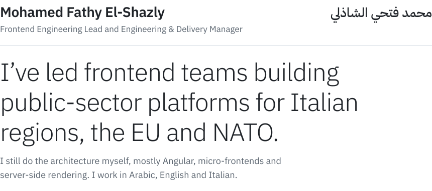
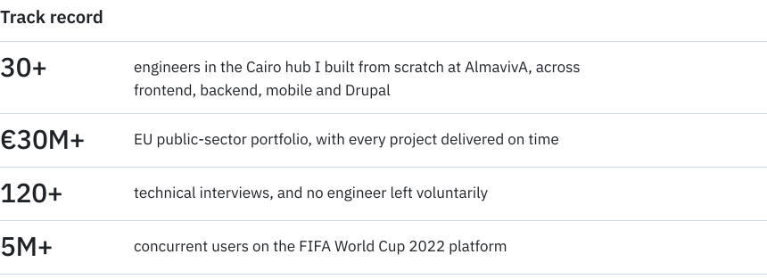
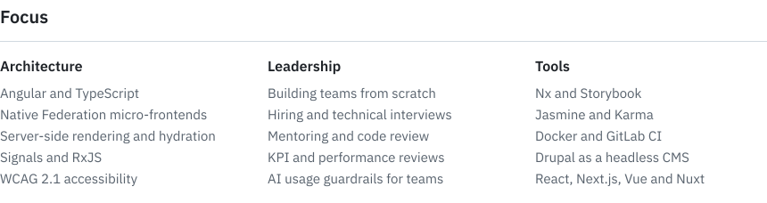

<picture>
  <source media="(max-width: 600px) and (prefers-color-scheme: dark)" srcset="https://raw.githubusercontent.com/M0hamedFathy/M0hamedFathy/HEAD/assets/masthead-phone-dark.svg">
  <source media="(max-width: 600px)" srcset="https://raw.githubusercontent.com/M0hamedFathy/M0hamedFathy/HEAD/assets/masthead-phone-light.svg">
  <source media="(prefers-color-scheme: dark)" srcset="https://raw.githubusercontent.com/M0hamedFathy/M0hamedFathy/HEAD/assets/masthead-desk-dark.svg">
  
</picture>

<a href="mailto:mohamedfathyelshazli@gmail.com"><picture><source media="(prefers-color-scheme: dark)" srcset="https://raw.githubusercontent.com/M0hamedFathy/M0hamedFathy/HEAD/assets/btn-email-dark.svg"></picture></a>&nbsp;
<a href="https://linkedin.com/in/m0hamed-fathy"><picture><source media="(prefers-color-scheme: dark)" srcset="https://raw.githubusercontent.com/M0hamedFathy/M0hamedFathy/HEAD/assets/btn-linkedin-dark.svg"></picture></a>&nbsp;
<a href="https://stackoverflow.com/users/19425971/mohamed-fathy"><picture><source media="(prefers-color-scheme: dark)" srcset="https://raw.githubusercontent.com/M0hamedFathy/M0hamedFathy/HEAD/assets/btn-stackoverflow-dark.svg"></picture></a>

<picture>
  <source media="(max-width: 600px) and (prefers-color-scheme: dark)" srcset="https://raw.githubusercontent.com/M0hamedFathy/M0hamedFathy/HEAD/assets/work-phone-dark.svg">
  <source media="(max-width: 600px)" srcset="https://raw.githubusercontent.com/M0hamedFathy/M0hamedFathy/HEAD/assets/work-phone-light.svg">
  <source media="(prefers-color-scheme: dark)" srcset="https://raw.githubusercontent.com/M0hamedFathy/M0hamedFathy/HEAD/assets/work-desk-dark.svg">
  
</picture>

<picture>
  <source media="(max-width: 600px) and (prefers-color-scheme: dark)" srcset="https://raw.githubusercontent.com/M0hamedFathy/M0hamedFathy/HEAD/assets/record-phone-dark.svg">
  <source media="(max-width: 600px)" srcset="https://raw.githubusercontent.com/M0hamedFathy/M0hamedFathy/HEAD/assets/record-phone-light.svg">
  <source media="(prefers-color-scheme: dark)" srcset="https://raw.githubusercontent.com/M0hamedFathy/M0hamedFathy/HEAD/assets/record-desk-dark.svg">
  
</picture>

<picture>
  <source media="(max-width: 600px) and (prefers-color-scheme: dark)" srcset="https://raw.githubusercontent.com/M0hamedFathy/M0hamedFathy/HEAD/assets/focus-phone-dark.svg">
  <source media="(max-width: 600px)" srcset="https://raw.githubusercontent.com/M0hamedFathy/M0hamedFathy/HEAD/assets/focus-phone-light.svg">
  <source media="(prefers-color-scheme: dark)" srcset="https://raw.githubusercontent.com/M0hamedFathy/M0hamedFathy/HEAD/assets/focus-desk-dark.svg">
  
</picture>

